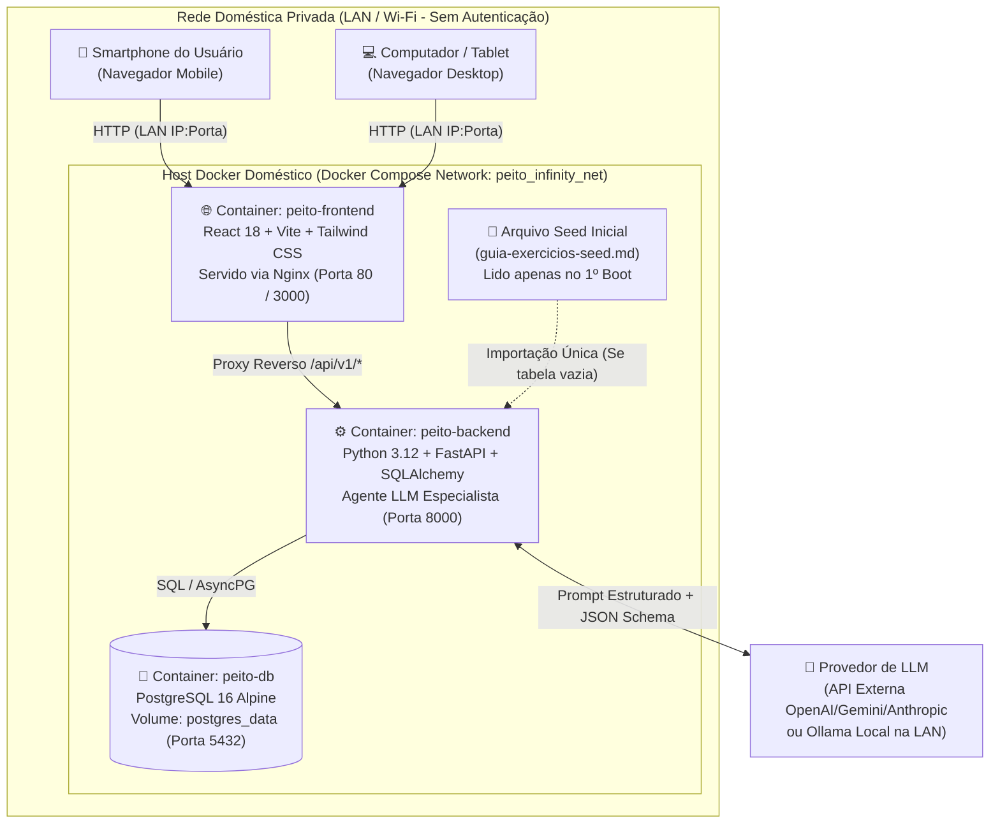
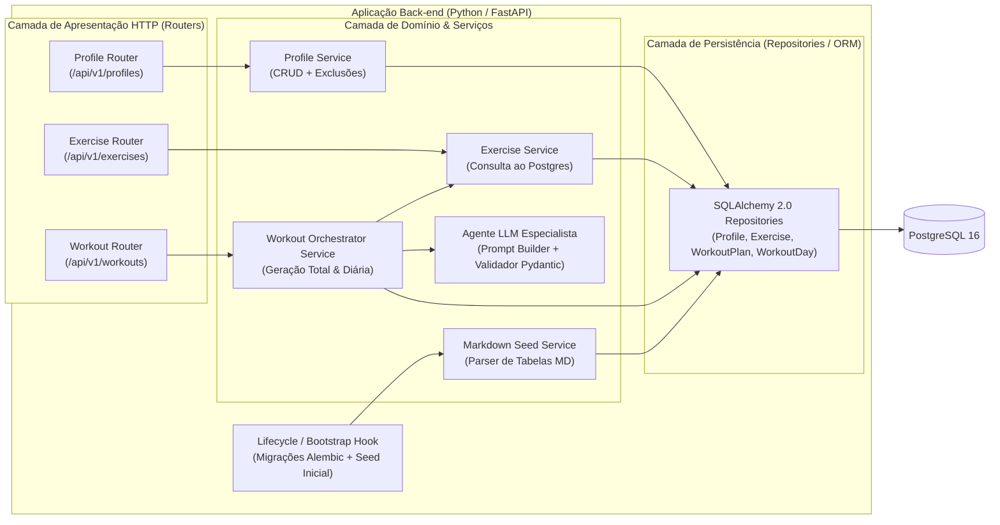
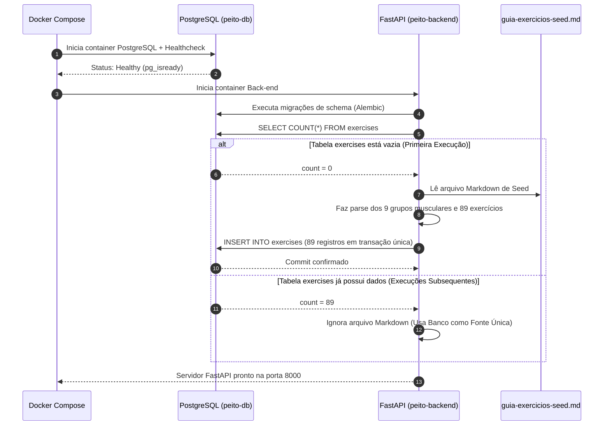
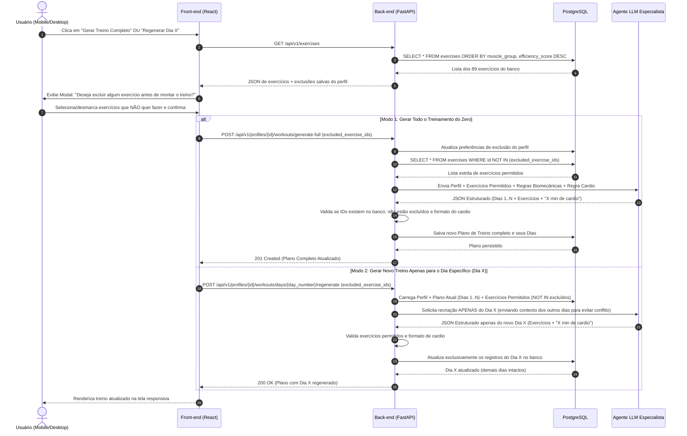

# 02. Especificação de Arquitetura de Sistema e Infraestrutura Docker

**Projeto:** Peito Infinity  
**Documento:** Arquitetura C4, Topologia de Rede Privada, Fluxos de Sequência e Orquestração Docker  
**Status:** Especificação Base (SDD)  

---

## 1. Visão Geral da Arquitetura

O **Peito Infinity** adota uma arquitetura em **3 Camadas Containerizadas** (*Three-Tier Containerized Architecture*), executada integralmente dentro de uma rede local doméstica (LAN) sob orquestração do **Docker Compose**:

1. **Camada de Apresentação (Front-end Web Responsivo):** Single Page Application (SPA) desenvolvida em **JavaScript com React + Vite + Tailwind CSS**, servida em produção por um container **Nginx** que também atua como *Reverse Proxy* para encaminhar requisições `/api/*` ao back-end (eliminando problemas de CORS e expondo uma única porta na rede doméstica).
2. **Camada de Aplicação e Inteligência (Back-end API + Agente LLM):** Serviço em **Python com FastAPI**, estruturado segundo princípios de *Clean Architecture / Layered Architecture* (Routers -> Services/Use Cases -> LLM Agent Orchestrator -> Repositories -> SQLAlchemy ORM).
3. **Camada de Persistência (Banco de Dados):** Container **PostgreSQL 16** com volume persistente, atuando como única fonte de verdade para Perfis, Catálogo de Exercícios (populado via Seed inicial) e Planos/Dias de Treino.

---

## 2. Diagrama de Contexto e Topologia em Rede Doméstica (C4 Nível 1 & 2)

---

## 3. Arquitetura Interna de Componentes (C4 Nível 3)

### 3.1 Componentes do Back-end (Python / FastAPI)

### 3.2 Componentes do Front-end (JavaScript / React)

| Módulo / Diretório Lógico | Responsabilidade Arquitetural |
| :--- | :--- |
| **`pages/ProfileSelectorPage`** | Tela inicial sem login: exibe cards dos perfis cadastrados e botão de criar novo perfil. |
| **`pages/ProfileFormModal`** | Formulário de criação e edição de perfil (nome, peso, altura, condicionamento, objetivo, minutos/dia, dias/semana). |
| **`pages/WorkoutDashboardPage`** | Painel principal do perfil selecionado: resumo das métricas do usuário, abas para cada dia da semana (`Dia 1` .. `Dia N`), card de cardio em minutos e lista de exercícios do dia. |
| **`components/ExerciseExclusionModal`** | Modal obrigatório exibido **antes de gerar qualquer treino**: lista os exercícios vindos do PostgreSQL agrupados por músculo, permitindo desmarcar/excluir exercícios indesejados antes de chamar o Agente LLM. |
| **`services/apiClient`** | Cliente HTTP centralizado para comunicação com `/api/v1/*` gerenciado via TanStack Query. |

---

## 4. Fluxos de Sequência (Diagramas de Sequência)

### 4.1 Inicialização do Sistema e Importação Inicial (Seed)

Garante que o arquivo Markdown seja usado apenas na primeira execução e que o banco PostgreSQL seja a fonte oficial de dados para os treinos.

---

### 4.2 Fluxo de Geração de Treino (Completo do Zero ou Dia Específico) com Exclusão Prévia

---

## 5. Especificação da Infraestrutura Docker

Para garantir portabilidade absoluta e execução simples em qualquer máquina da rede doméstica, a arquitetura define três containers coordenados por `docker-compose`.

### 5.1 Matriz de Containers e Serviços

| Nome do Serviço | Imagem Base Recomendada | Porta Interna | Porta Exposta (LAN) | Dependências (`depends_on`) | Volumes |
| :--- | :--- | :--- | :--- | :--- | :--- |
| **`db`** | `postgres:16-alpine` | `5432` | `5432` (opcional p/ debug) | Nenhuma | `postgres_data:/var/lib/postgresql/data` |
| **`backend`** | `python:3.12-slim` | `8000` | `8000` (Swagger/API) | `db` (`service_healthy`) | Leitura do arquivo seed embutido na imagem |
| **`frontend`** | Build: `node:20-alpine` -> Runtime: `nginx:stable-alpine` | `80` | `80` (ou `3000`) | `backend` (`service_started`) | Nenhum (artefatos estáticos compilados) |

### 5.2 Variáveis de Ambiente Especificadas (`.env.example`)

| Variável | Serviço Alvo | Descrição | Valor Padrão / Exemplo |
| :--- | :--- | :--- | :--- |
| `POSTGRES_USER` | `db`, `backend` | Usuário do banco PostgreSQL | `peito_user` |
| `POSTGRES_PASSWORD` | `db`, `backend` | Senha do banco PostgreSQL interno | `peito_secret_lan` |
| `POSTGRES_DB` | `db`, `backend` | Nome da base de dados | `peito_infinity` |
| `DATABASE_URL` | `backend` | String de conexão SQLAlchemy | `postgresql+psycopg://peito_user:peito_secret_lan@db:5432/peito_infinity` |
| `SEED_FILE_PATH` | `backend` | Caminho do arquivo Markdown para 1ª execução | `/app/seed/guia-exercicios-seed.md` |
| `LLM_PROVIDER` | `backend` | Provedor do Agente LLM (`openai`, `gemini`, `ollama`) | `openai` ou `gemini` |
| `LLM_MODEL` | `backend` | Modelo utilizado pelo Agente Especialista | `gpt-4o-mini` / `gemini-2.5-flash` |
| `LLM_API_KEY` | `backend` | Chave de API do provedor LLM (ou vazio se Ollama local) | `sk-...` |
| `VITE_API_BASE_URL` | `frontend` | Caminho base da API via Proxy Reverso Nginx | `/api/v1` |

### 5.3 Topologia de Rede Doméstica (Acesso Mobile e Desktop)
- O serviço `frontend` faz *bind* em `0.0.0.0:80` (ou `0.0.0.0:3000`) no computador/servidor doméstico onde o Docker está rodando.
- Qualquer celular ou computador conectado ao mesmo roteador Wi-Fi doméstico acessa `http://<IP-LOCAL-DO-HOST>:3000` (ex: `http://192.168.1.50:3000`) diretamente pelo navegador, sem configuração adicional e sem necessidade de login.
