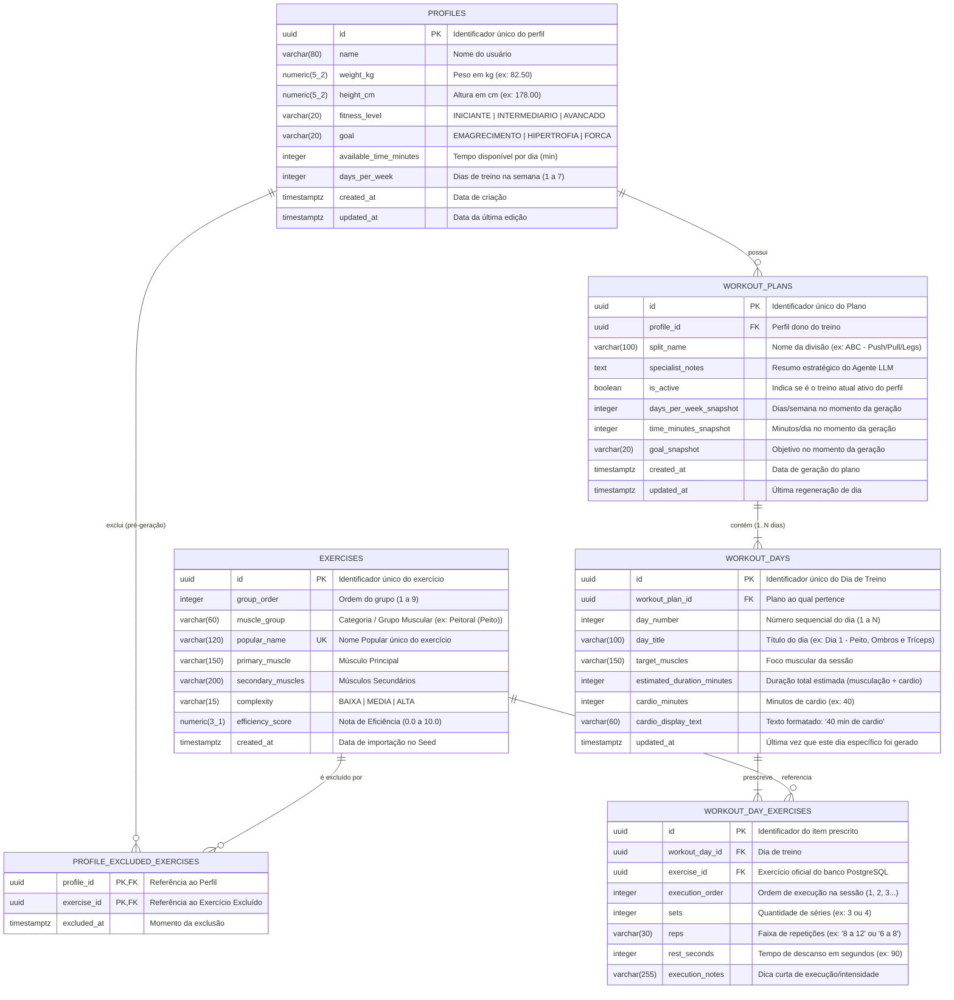

# 03. Especificação do Modelo de Dados (PostgreSQL) e Carga Inicial (Seed)

**Projeto:** Peito Infinity  
**Documento:** Diagrama Entidade-Relacionamento (DER), Dicionário de Dados, Enums e Especificação de Seed  
**Status:** Especificação Base (SDD)  

---

## 1. Visão Geral do Banco de Dados

O banco de dados **PostgreSQL 16** é o repositório central e a **única fonte de dados em tempo de execução** para os exercícios de musculação, perfis de usuários, listas de exclusão de exercícios e planos/dias de treino gerados pelo Agente LLM.

---

## 2. Diagrama Entidade-Relacionamento (DER)

---

## 3. Dicionário de Dados Detalhado

### 3.1 Tabela `profiles` (Perfis de Usuário)
Armazena os perfis criados diretamente na tela do aplicativo (sem autenticação). Todos os campos de negócio são editáveis.

| Coluna | Tipo PostgreSQL | Nulo? | Restrições / Regras | Descrição |
| :--- | :--- | :--- | :--- | :--- |
| `id` | `UUID` | Não | `PRIMARY KEY`, Default `gen_random_uuid()` | Identificador único do perfil. |
| `name` | `VARCHAR(80)` | Não | `CHECK (char_length(trim(name)) >= 2)` | Nome do usuário exibido na seleção de perfil. |
| `weight_kg` | `NUMERIC(5,2)` | Não | `CHECK (weight_kg >= 25.0 AND weight_kg <= 300.0)` | Peso corporal em quilogramas. |
| `height_cm` | `NUMERIC(5,2)` | Não | `CHECK (height_cm >= 100.0 AND height_cm <= 250.0)` | Altura em centímetros. |
| `fitness_level` | `VARCHAR(20)` | Não | `CHECK (fitness_level IN ('INICIANTE', 'INTERMEDIARIO', 'AVANCADO'))` | Nível de condicionamento físico. |
| `goal` | `VARCHAR(20)` | Não | `CHECK (goal IN ('EMAGRECIMENTO', 'HIPERTROFIA', 'FORCA'))` | Objetivo principal do usuário. |
| `available_time_minutes` | `INTEGER` | Não | `CHECK (available_time_minutes >= 20 AND available_time_minutes <= 240)` | Tempo disponível em minutos para cada dia de treino. |
| `days_per_week` | `INTEGER` | Não | `CHECK (days_per_week >= 1 AND days_per_week <= 7)` | Quantidade de dias na semana em que o usuário vai treinar. |
| `created_at` | `TIMESTAMPTZ` | Não | Default `NOW()` | Timestamp de criação do perfil. |
| `updated_at` | `TIMESTAMPTZ` | Não | Default `NOW()` | Timestamp da última edição do perfil. |

---

### 3.2 Tabela `exercises` (Catálogo Oficial de Exercícios)
Populada na primeira execução a partir do arquivo [guia-exercicios-seed.md](file:///c:/projetos/peito-infinity-v2/specs/data/guia-exercicios-seed.md) e utilizada como **única fonte de verdade** para o aplicativo e para o Agente LLM.

| Coluna | Tipo PostgreSQL | Nulo? | Restrições / Regras | Descrição |
| :--- | :--- | :--- | :--- | :--- |
| `id` | `UUID` | Não | `PRIMARY KEY`, Default `gen_random_uuid()` | Identificador único do exercício no banco. |
| `group_order` | `INTEGER` | Não | `CHECK (group_order BETWEEN 1 AND 9)` | Número da seção no guia (1 a 9) para ordenação padronizada na UI. |
| `muscle_group` | `VARCHAR(60)` | Não | Indexado (`idx_exercises_muscle_group`) | Nome do grupo muscular (ex: `Peitoral (Peito)`, `Costas (Dorsais e Parte Superior das Costas)`). |
| `popular_name` | `VARCHAR(120)` | Não | `UNIQUE` | Nome popular do exercício (ex: `Supino Reto com Halteres`). |
| `primary_muscle` | `VARCHAR(150)` | Não | — | Músculo principal recrutado. |
| `secondary_muscles` | `VARCHAR(200)` | Não | — | Músculos secundários recrutados (ou `Nenhum significativo`). |
| `complexity` | `VARCHAR(15)` | Não | `CHECK (complexity IN ('BAIXA', 'MEDIA', 'ALTA'))` | Nível de complexidade motora (mapeado de 🟢 Baixa, 🟡 Média, 🔴 Alta). |
| `efficiency_score` | `NUMERIC(3,1)` | Não | `CHECK (efficiency_score >= 0.0 AND efficiency_score <= 10.0)` | Nota de eficiência de 0 a 10 (ex: `9.8`). |
| `created_at` | `TIMESTAMPTZ` | Não | Default `NOW()` | Data de importação no banco. |

---

### 3.3 Tabela `profile_excluded_exercises` (Exercícios Excluídos pelo Usuário)
Tabela associativa (`N:N`) que registra quais exercícios o usuário marcou para **excluir** antes da geração do treino.

| Coluna | Tipo PostgreSQL | Nulo? | Restrições / Regras | Descrição |
| :--- | :--- | :--- | :--- | :--- |
| `profile_id` | `UUID` | Não | `PRIMARY KEY`, `FOREIGN KEY (profiles.id) ON DELETE CASCADE` | Perfil que excluiu o exercício. |
| `exercise_id` | `UUID` | Não | `PRIMARY KEY`, `FOREIGN KEY (exercises.id) ON DELETE CASCADE` | Exercício banido da montagem do treino para este perfil. |
| `excluded_at` | `TIMESTAMPTZ` | Não | Default `NOW()` | Data/hora em que a exclusão foi aplicada. |

---

### 3.4 Tabela `workout_plans` (Planos de Treinamento Semanal)
Representa o plano de treinamento do usuário. Quando o usuário gera "todo um treinamento do zero", um novo `workout_plan` ativo é gravado (ou o plano ativo é substituído).

| Coluna | Tipo PostgreSQL | Nulo? | Restrições / Regras | Descrição |
| :--- | :--- | :--- | :--- | :--- |
| `id` | `UUID` | Não | `PRIMARY KEY`, Default `gen_random_uuid()` | Identificador único do plano de treino. |
| `profile_id` | `UUID` | Não | `FOREIGN KEY (profiles.id) ON DELETE CASCADE` | Perfil proprietário do plano. |
| `split_name` | `VARCHAR(100)` | Não | — | Nome da divisão sugerida pelo Agente LLM (ex: `Upper / Lower 4x`, `ABC Hipertrofia`). |
| `specialist_notes` | `TEXT` | Sim | — | Explicação resumida do Agente LLM sobre a lógica daquele plano. |
| `is_active` | `BOOLEAN` | Não | Default `TRUE` | Indica o plano vigente exibido no painel do perfil. |
| `days_per_week_snapshot` | `INTEGER` | Não | — | Quantidade de dias na semana considerada na geração. |
| `time_minutes_snapshot` | `INTEGER` | Não | — | Tempo diário em minutos considerado na geração. |
| `goal_snapshot` | `VARCHAR(20)` | Não | — | Objetivo considerado no momento da geração. |
| `created_at` | `TIMESTAMPTZ` | Não | Default `NOW()` | Data da geração completa. |
| `updated_at` | `TIMESTAMPTZ` | Não | Default `NOW()` | Atualizado quando qualquer dia do plano é regenerado. |

---

### 3.5 Tabela `workout_days` (Dias de Treino Específicos)
Representa cada dia individual da semana (`Dia 1` até `Dia N`). Quando o usuário escolhe **"gerar um novo treino apenas para aquele dia em específico"**, somente o registro correspondente de `workout_days` (e seus itens em `workout_day_exercises`) é recriado.

| Coluna | Tipo PostgreSQL | Nulo? | Restrições / Regras | Descrição |
| :--- | :--- | :--- | :--- | :--- |
| `id` | `UUID` | Não | `PRIMARY KEY`, Default `gen_random_uuid()` | Identificador único do dia de treino. |
| `workout_plan_id` | `UUID` | Não | `FOREIGN KEY (workout_plans.id) ON DELETE CASCADE` | Referência ao plano semanal. |
| `day_number` | `INTEGER` | Não | `CHECK (day_number >= 1 AND day_number <= 7)`, `UNIQUE(workout_plan_id, day_number)` | Número do dia na semana de treino (`1` a `N`). |
| `day_title` | `VARCHAR(100)` | Não | — | Nome descritivo (ex: `Dia 1 — Peito, Ombros e Tríceps`). |
| `target_muscles` | `VARCHAR(150)` | Não | — | Grupos musculares trabalhados no dia. |
| `estimated_duration_minutes` | `INTEGER` | Não | `CHECK (estimated_duration_minutes > 0)` | Tempo total estimado da sessão (respeitando `available_time_minutes`). |
| `cardio_minutes` | `INTEGER` | Não | `CHECK (cardio_minutes >= 0)` | Tempo de exercício cardiovascular em minutos (ex: `40`). |
| `cardio_display_text` | `VARCHAR(60)` | Não | Formato obrigatório: `"{X} min de cardio"` | String pronta para exibição na UI conforme requisito (ex: `"40 min de cardio"`). |
| `updated_at` | `TIMESTAMPTZ` | Não | Default `NOW()` | Data/hora da última geração/regeneração deste dia específico. |

---

### 3.6 Tabela `workout_day_exercises` (Exercícios Prescritos no Dia)
Itens de musculação prescritos pelo Agente LLM para um `workout_day`, obrigatoriamente vinculados a um registro válido de `exercises`.

| Coluna | Tipo PostgreSQL | Nulo? | Restrições / Regras | Descrição |
| :--- | :--- | :--- | :--- | :--- |
| `id` | `UUID` | Não | `PRIMARY KEY`, Default `gen_random_uuid()` | Identificador do item prescrito. |
| `workout_day_id` | `UUID` | Não | `FOREIGN KEY (workout_days.id) ON DELETE CASCADE` | Dia de treino ao qual pertence. |
| `exercise_id` | `UUID` | Não | `FOREIGN KEY (exercises.id) ON DELETE RESTRICT` | Exercício referenciado da base PostgreSQL. |
| `execution_order` | `INTEGER` | Não | `CHECK (execution_order >= 1)`, `UNIQUE(workout_day_id, execution_order)` | Ordem de execução (iniciando pelos de complexidade Alta/Média e finalizando com Baixa). |
| `sets` | `INTEGER` | Não | `CHECK (sets >= 1 AND sets <= 10)` | Número de séries prescritas. |
| `reps` | `VARCHAR(30)` | Não | — | Faixa de repetições ou tempo isométrico (ex: `"8 a 10"`, `"12 a 15"`, `"45 seg"`). |
| `rest_seconds` | `INTEGER` | Não | `CHECK (rest_seconds >= 15 AND rest_seconds <= 300)` | Descanso entre séries em segundos (ex: `60`, `90`, `120`, `180`). |
| `execution_notes` | `VARCHAR(255)` | Sim | — | Observação curta do especialista (ex: `"Controlar a fase excêntrica"`, `"Ir até a falha na última série"`). |

---

## 4. Especificação do Processo de Importação Inicial (Database Seed)

### 4.1 Regras de Parsing e Transformação do Arquivo Markdown
Na primeira execução do sistema, o serviço de inicialização (`SeedService`) deve analisar o arquivo [guia-exercicios-seed.md](file:///c:/projetos/peito-infinity-v2/specs/data/guia-exercicios-seed.md) seguindo estas regras determinísticas:

1. **Verificação de Idempotência:**
   - Executar `SELECT COUNT(*) FROM exercises;`.
   - Se o resultado for `> 0`, abortar a importação silenciosamente (registrando em log: `"Database already seeded with exercises. Skipping Markdown import."`).
2. **Identificação de Grupos Musculares (`muscle_group` e `group_order`):**
   - Cabeçalhos Markdown de nível 2 no padrão `## {N}. {Nome do Grupo}` definem `group_order = N` e `muscle_group = {Nome do Grupo}`.
   - Os 9 grupos oficiais do arquivo são:
     1. `Peitoral (Peito)` — 14 exercícios
     2. `Costas (Dorsais e Parte Superior das Costas)` — 12 exercícios
     3. `Quadríceps (Parte Anterior da Coxa)` — 11 exercícios
     4. `Posterior de Coxa (Isquiotibiais) e Glúteos` — 13 exercícios
     5. `Ombros (Deltoides) e Trapézio` — 12 exercícios
     6. `Bíceps e Antebraço` — 10 exercícios
     7. `Tríceps` — 9 exercícios
     8. `Panturrilhas e Tibial` — 4 exercícios
     9. `Abdômen e Core` — 9 exercícios
     - **Total exato esperado no Seed:** **94 exercícios**.
3. **Limpeza e Normalização das Colunas das Tabelas Markdown:**
   - **Nome Popular (`popular_name`):** Remover asteriscos de negrito (`**`). Exemplo: `**Supino Reto com Halteres**` -> `Supino Reto com Halteres`.
   - **Músculo Principal (`primary_muscle`):** Texto limpo da 2ª coluna.
   - **Músculos Secundários (`secondary_muscles`):** Remover asteriscos de itálico (`*`). Exemplo: `*Nenhum significativo*` -> `Nenhum significativo`.
   - **Complexidade (`complexity`):**
     - Contém `Baixa` (🟢 Baixa) -> `'BAIXA'`
     - Contém `Média` (🟡 Média) -> `'MEDIA'`
     - Contém `Alta` (🔴 Alta) -> `'ALTA'`
   - **Eficiência (`efficiency_score`):**
     - Remover `**` e o sufixo `/10`, convertendo para `NUMERIC(3,1)`. Exemplo: `**9.8/10**` -> `9.8`.
4. **Transação Atômica:**
   - Todos os 89 registros devem ser inseridos em uma única transação de banco de dados (`COMMIT` ao final). Caso ocorra qualquer falha, realizar `ROLLBACK` e impedir o boot silencioso com base incompleta.
