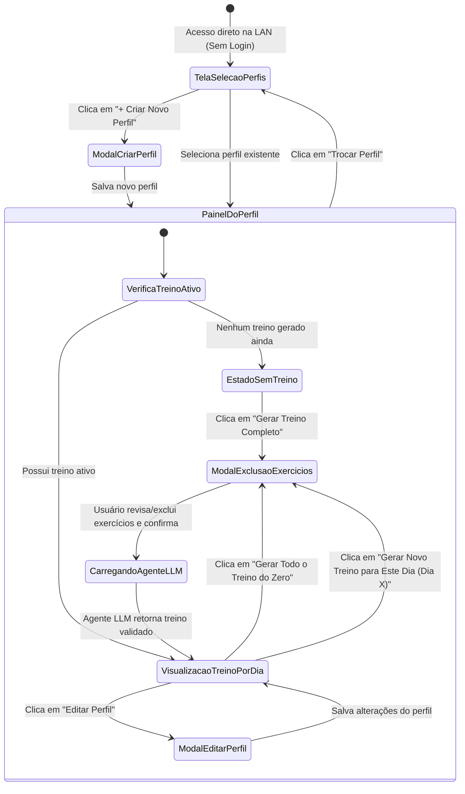

# 06. Especificação de Interface Responsiva e Experiência do Usuário (UI/UX)

**Projeto:** Peito Infinity  
**Documento:** Fluxos de Navegação, Wireframes Estruturais, Responsividade (Mobile & Desktop) e Estados da UI  
**Status:** Especificação Base (SDD)  

---

## 1. Diretrizes de Design e Responsividade

O **Peito Infinity** é utilizado em dois contextos principais dentro da rede doméstica:
1. **No Smartphone (Mobile):** Enquanto o usuário está se preparando para ir à academia ou consultando o treino rápido no celular.
2. **No Computador/Tablet (Desktop):** Para planejamento confortável, criação/edição de perfil e revisão detalhada dos exercícios excluídos.

### 1.1 Breakpoints Responsivos (Tailwind CSS)

| Breakpoint | Largura da Tela | Comportamento do Layout |
| :--- | :--- | :--- |
| **Mobile (`default` / `< 640px`)** | `320px` a `639px` | Coluna única (`grid-cols-1`), abas de dias de treino com scroll horizontal suave (`overflow-x-auto`), modais em estilo *Bottom Sheet* / tela cheia, botões de ação largos (`w-full`, altura mínima `48px`). |
| **Tablet (`sm` / `md`: `640px` a `1023px`)** | `640px` a `1023px` | Grid de 2 colunas para perfis e grupos de exercícios (`grid-cols-2`), cabeçalho compacto com métricas resumidas. |
| **Desktop (`lg` / `xl`: `>= 1024px`)** | `1024px` a `1920px+` | Container centralizado (`max-w-7xl`), layout dividido em Sidebar de Perfil + Área Principal do Treino (`grid-cols-12`), abas de todos os dias visíveis simultaneamente. |

---

## 2. Fluxo Completo de Navegação do Usuário

---

## 3. Especificação Detalhada das Telas e Modais

### 3.1 Tela 1: Seletor de Perfis (`ProfileSelectorPage` — Rota `/`)
Como o aplicativo roda em rede doméstica e **não possui autenticação**, a tela inicial permite que qualquer pessoa da casa selecione seu perfil ou crie um novo imediatamente.

- **Elementos da Tela:**
  - **Cabeçalho:** Logotipo e nome **"Peito Infinity"** + subtítulo *"Gerenciador Inteligente de Treinos"*.
  - **Grade de Perfis Cadastrados:** Cards clicáveis mostrando:
    - Avatar com as iniciais do nome.
    - **Nome do Usuário**.
    - Badges resumidas: Objetivo (`Emagrecimento`, `Hipertrofia` ou `Treino de Força`), Nível (`Iniciante`, `Intermediário`, `Avançado`), `X dias/sem` e `Y min/dia`.
  - **Card / Botão de Ação Primária (`+ Novo Perfil`):** Abre o modal de criação de perfil.

---

### 3.2 Modal 1: Criação e Edição de Perfil (`ProfileFormModal`)
Utilizado tanto para criar um perfil quanto para editar os dados do perfil a qualquer momento.

- **Campos do Formulário:**
  1. **Nome:** Campo de texto (`input type="text"`), ex: *"Lucas"*.
  2. **Peso (kg):** Campo numérico com passo decimal (`input type="number" step="0.1"`), ex: `78.5`.
  3. **Altura (cm):** Campo numérico (`input type="number"`), ex: `175`.
  4. **Nível de Condicionamento Físico:** Seleção em cards/botões segmentados:
     - `Iniciante`
     - `Intermediário`
     - `Avançado`
  5. **Objetivo:** Seleção em cards visuais:
     - `Emagrecimento`
     - `Hipertrofia`
     - `Treino de Força`
  6. **Tempo disponível por dia de treino (minutos):** Campo numérico ou slider acompanhado de input (`20` a `240` min), ex: `60 min`.
  7. **Quantos dias na semana vai treinar:** Seletor de botões `1`, `2`, `3`, `4`, `5`, `6`, `7` dias/semana.
- **Ações:** Botão `"Cancelar"` e Botão `"Salvar Perfil"`.

---

### 3.3 Tela 2: Painel do Perfil e Gerenciador de Treinos (`WorkoutDashboardPage` — Rota `/profiles/:id`)

É a tela principal de uso diário do aplicativo.

- **Bloco Superior — Resumo do Perfil e Ações Globais:**
  - Exibe Nome, Peso (`kg`), Altura (`cm`), Condicionamento, Objetivo, Tempo Disponível (`min/dia`) e Frequência (`dias/semana`).
  - **Botão `"Editar Perfil"`:** Abre o `ProfileFormModal` preenchido com os dados atuais para edição imediata.
  - **Botão `"Trocar Perfil"`:** Retorna para a tela inicial de perfis.
  - **Botão Primário `"Gerar Treino do Zero"`:** Abre o Modal de Exclusão de Exercícios configurado no modo `FULL_PLAN` (gera toda a semana novamente).

- **Bloco Central — Navegação por Dias da Semana (`Dia 1` até `Dia N`):**
  - Barra de abas (Tabs) correspondente aos dias do plano ativo:
    - Exemplo para 4 dias: `[ Dia 1 ]` `[ Dia 2 ]` `[ Dia 3 ]` `[ Dia 4 ]`.
  - Cabeçalho do Dia Selecionado:
    - Título do dia (ex: *"Dia 1 — Peito, Ombros e Tríceps"*).
    - Grupos musculares foco e duração total estimada (ex: *"58 min estimados de 60 min disponíveis"*).
    - **Botão de Ação Específica do Dia (`"🔄 Gerar Novo Treino para Este Dia"`):** Abre o Modal de Exclusão de Exercícios configurado no modo `SINGLE_DAY` (regenera apenas o dia selecionado mantendo os demais dias intactos).

- **Bloco de Exercícios do Dia Selecionado:**
  1. **Lista Ordenada de Exercícios de Musculação:**
     - Cada card de exercício exibe:
       - Número de ordem (`#1`, `#2`...).
       - **Nome Popular do Exercício** (ex: *Supino Reto com Halteres*).
       - **Músculo Principal** e **Músculos Secundários**.
       - Badge de **Complexidade** com cor semântica:
         - 🟢 `Baixa` (Verde)
         - 🟡 `Média` (Amarelo/Âmbar)
         - 🔴 `Alta` (Vermelho/Coral)
       - Badge de **Nota de Eficiência** (ex: `⭐ 9.8/10`).
       - Prescrição destacada: **Séries x Repetições** (ex: `4 séries x 8 a 10 reps`) e **Descanso** (ex: `90s descanso`).
       - Observação técnica do Agente LLM.
  2. **Card Destacado de Exercício Cardiovascular (Regra de Tempo Exclusivo):**
     - Exibido com ícone de cardio/cronômetro e mostra **apenas o tempo**, exatamente como especificado:
       - Exemplo visual: **`🏃 40 min de cardio`** (sem séries, sem repetições e sem carga).

---

### 3.4 Modal 2: Seleção de Exclusão de Exercícios Pré-Geração (`ExerciseExclusionModal`)

> [!IMPORTANT]
> **Requisito Obrigatório de Fluxo:** Antes de gerar qualquer treino (seja o treino completo do zero ou a regeneração de um dia específico), este modal **sempre** é exibido ao usuário perguntando se ele deseja excluir algum exercício da lista para que não seja utilizado na montagem do treino.

- **Elementos do Modal:**
  - **Título Claro:** *"Algum exercício que você NÃO quer no seu treino?"*
  - **Subtítulo Explicativo:** *"Desmarque ou exclua abaixo os exercícios que você não gosta, não pode fazer ou cujo aparelho não existe na sua academia. O Agente Especialista não usará nenhum exercício excluído."*
  - **Barra de Busca e Filtro Rápido:**
    - Campo de busca por nome (ex: digitar *"Agachamento"* ou *"Barra Fixa"*).
    - Filtro por grupo muscular (Todos, Peitoral, Costas, Quadríceps, Posterior/Glúteos, Ombros, Bíceps, Tríceps, Panturrilhas, Abdômen) e por Complexidade (🟢 Baixa, 🟡 Média, 🔴 Alta).
  - **Acordeões/Listas dos 9 Grupos Musculares (Carregados do PostgreSQL):**
    - Cada exercício possui um *toggle/checkbox* claro indicando se está **Permitido (Incluído)** ou **Excluído (Banido)**.
    - Contador no rodapé: *"84 exercícios permitidos | 5 exercícios excluídos"*.
  - **Botões de Rodapé:**
    - `"Cancelar"`
    - `"Confirmar e Gerar Treino com IA"` (ou `"Pular sem excluir nenhum e Gerar"` caso o usuário não queira excluir nada).
