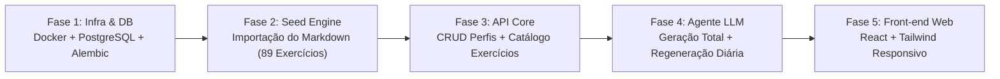

# 07. Plano de Verificação, Matriz de Rastreabilidade e Roadmap SDD

**Projeto:** Peito Infinity  
**Documento:** Rastreabilidade de Requisitos, Plano de Testes e Fases de Implementação  
**Status:** Especificação Base (SDD)  

---

## 1. Matriz de Rastreabilidade de Requisitos (RTM)

Esta matriz comprova que 100% dos requisitos solicitados para o **Peito Infinity** estão formalizados na especificação:

| Requisito do Usuário | Documento SDD de Referência | Critério de Verificação |
| :--- | :--- | :--- |
| **Aplicativo web no navegador, responsivo (Mobile e Desktop)** | [00-constitution-and-vision.md](file:///c:/projetos/peito-infinity-v2/specs/00-constitution-and-vision.md), [06-ui-ux-responsive-spec.md](file:///c:/projetos/peito-infinity-v2/specs/06-ui-ux-responsive-spec.md) | Layout fluido React + Tailwind CSS validado em viewports `375x812` (Mobile) e `1440x900` (Desktop). |
| **Uso de Docker e Banco de Dados PostgreSQL** | [02-system-architecture.md](file:///c:/projetos/peito-infinity-v2/specs/02-system-architecture.md), [03-data-model-and-seed-spec.md](file:///c:/projetos/peito-infinity-v2/specs/03-data-model-and-seed-spec.md) | Orquestração via `docker-compose` com container `postgres:16-alpine` e volume persistente. |
| **Back-end em Python e Front-end em JavaScript (frameworks mais populares)** | [00-constitution-and-vision.md](file:///c:/projetos/peito-infinity-v2/specs/00-constitution-and-vision.md), [02-system-architecture.md](file:///c:/projetos/peito-infinity-v2/specs/02-system-architecture.md) | Back-end em **FastAPI + SQLAlchemy 2.0 + Pydantic v2**; Front-end em **React 18 + Vite + Tailwind CSS**. |
| **Executado em rede doméstica e privada, sem autenticação** | [00-constitution-and-vision.md](file:///c:/projetos/peito-infinity-v2/specs/00-constitution-and-vision.md), [01-product-requirements-prd.md](file:///c:/projetos/peito-infinity-v2/specs/01-product-requirements-prd.md) | Zero login/senha/JWT; acesso direto aos perfis pela LAN doméstica. |
| **Perfis criados na própria tela (nome, peso, altura, condicionamento, objetivo, tempo em min/dia, dias/semana)** | [01-product-requirements-prd.md](file:///c:/projetos/peito-infinity-v2/specs/01-product-requirements-prd.md), [03-data-model-and-seed-spec.md](file:///c:/projetos/peito-infinity-v2/specs/03-data-model-and-seed-spec.md) | Tabela `profiles` e endpoint `POST /api/v1/profiles` com os 7 campos obrigatórios e objetivos (`EMAGRECIMENTO`, `HIPERTROFIA`, `FORCA`). |
| **Agente LLM especialista em montar treinos** | [05-llm-agent-workout-spec.md](file:///c:/projetos/peito-infinity-v2/specs/05-llm-agent-workout-spec.md) | Agente com System Prompt biomecânico, matriz fisiológica e *Structured Outputs* validados. |
| **Exibir antes de gerar o treino se o usuário quer excluir algum exercício** | [04-api-contracts-spec.md](file:///c:/projetos/peito-infinity-v2/specs/04-api-contracts-spec.md), [06-ui-ux-responsive-spec.md](file:///c:/projetos/peito-infinity-v2/specs/06-ui-ux-responsive-spec.md) | `ExerciseExclusionModal` obrigatório antes de disparar `generate-full` ou `regenerate`, filtrando `excluded_exercise_ids`. |
| **Dados do perfil editáveis e geração ilimitada (todo do zero ou apenas para aquele dia específico)** | [01-product-requirements-prd.md](file:///c:/projetos/peito-infinity-v2/specs/01-product-requirements-prd.md), [04-api-contracts-spec.md](file:///c:/projetos/peito-infinity-v2/specs/04-api-contracts-spec.md) | Endpoints `PUT /api/v1/profiles/{id}`, `POST .../generate-full` e `POST .../days/{day_number}/regenerate`. |
| **Exercícios cardiovasculares informados apenas pelo tempo (ex: 40 min de cardio)** | [03-data-model-and-seed-spec.md](file:///c:/projetos/peito-infinity-v2/specs/03-data-model-and-seed-spec.md), [05-llm-agent-workout-spec.md](file:///c:/projetos/peito-infinity-v2/specs/05-llm-agent-workout-spec.md) | Campo `cardio_display_text` validado estritamente no padrão `"{X} min de cardio"`. |
| **Importação do arquivo Markdown para a base na 1ª execução e banco como única fonte de dados** | [02-system-architecture.md](file:///c:/projetos/peito-infinity-v2/specs/02-system-architecture.md), [03-data-model-and-seed-spec.md](file:///c:/projetos/peito-infinity-v2/specs/03-data-model-and-seed-spec.md) | `SeedService` importa os 89 exercícios de [guia-exercicios-seed.md](file:///c:/projetos/peito-infinity-v2/specs/data/guia-exercicios-seed.md) apenas se `COUNT(*) == 0`; consultas subsequentes usam 100% PostgreSQL. |

---

## 2. Plano de Testes e Verificação (QA Spec)

Quando a fase de codificação for iniciada a partir desta especificação, a suíte de verificação deverá cobrir os seguintes cenários:

### 2.1 Testes de Unidade e Integração de Banco / Seed (Back-end)
1. **Teste de Parse e Seed Inicial (`test_seed_service`):**
   - Executar o `SeedService` contra um banco PostgreSQL limpo.
   - Verificar que `SELECT COUNT(*) FROM exercises` retorna exatamente **89 exercícios** distribuídos nos **9 grupos musculares**.
   - Executar o `SeedService` uma segunda vez e verificar que nenhum registro é duplicado (idempotência).
2. **Teste de Isolamento da Fonte de Dados (`test_database_as_single_source`):**
   - Após o seed inicial, simular a indisponibilidade/remoção do arquivo Markdown e verificar que `GET /api/v1/exercises` e a geração de treinos continuam funcionando normalmente consultando apenas o PostgreSQL.

### 2.2 Testes de Contrato e Regras de Negócio da API
1. **Teste de CRUD de Perfil sem Autenticação (`test_profile_crud`):**
   - Criar perfil sem enviar qualquer header `Authorization`.
   - Editar `weight_kg`, `goal`, `available_time_minutes` e `days_per_week` via `PUT /api/v1/profiles/{id}` e validar persistência.
2. **Teste de Exclusão Estrita de Exercícios (`test_excluded_exercises_filtering`):**
   - Passar uma lista de `excluded_exercise_ids` para o gerador de treinos e garantir que a query SQL filtra todos esses IDs antes de montar o contexto do Agente LLM e que o validador pós-LLM bloqueia qualquer tentativa de uso de um ID excluído.
3. **Teste do Formato de Cardio (`test_cardio_format`):**
   - Verificar que em todos os dias gerados (`workout_days`), o texto do exercício cardiovascular segue a expressão regular `^\d+ min de cardio$` (ex: `"40 min de cardio"`).
4. **Teste de Regeneração de Dia Específico (`test_regenerate_single_day`):**
   - Gerar um plano de 4 dias (`Dia 1` a `Dia 4`).
   - Capturar os hashes/IDs dos exercícios dos Dias 1, 3 e 4.
   - Chamar `POST /api/v1/profiles/{id}/workouts/days/2/regenerate`.
   - Confirmar que o `Dia 2` recebeu um novo treino e que os Dias 1, 3 e 4 permaneceram 100% idênticos.

---

## 3. Roadmap de Implementação Orientado por Especificação (SDD Tasks)

Caso o desenvolvimento do código seja autorizado nas próximas etapas, ele deve seguir esta sequência de fases independentes e testáveis:

- **Fase 1 — Infraestrutura Docker & Banco de Dados:** Configuração do `docker-compose.yml`, container PostgreSQL 16, estrutura base do FastAPI, modelos SQLAlchemy 2.0 e migração inicial Alembic.
- **Fase 2 — Motor de Seed Inicial:** Implementação do parser que lê [guia-exercicios-seed.md](file:///c:/projetos/peito-infinity-v2/specs/data/guia-exercicios-seed.md) na primeira execução e popula a tabela `exercises` no PostgreSQL.
- **Fase 3 — API de Perfis e Catálogo de Exercícios:** Implementação dos endpoints RESTful para criar/listar/editar/excluir perfis e listar exercícios do banco.
- **Fase 4 — Agente LLM Especialista em Treinos:** Implementação do orquestrador LLM com *Structured Outputs*, filtro de exercícios excluídos, regra de cardio em minutos, geração completa do zero e regeneração de dia único.
- **Fase 5 — Front-end Responsivo (Mobile & Desktop):** Implementação da SPA em React + Vite + Tailwind CSS com seletor/editor de perfis, modal obrigatório de exclusão de exercícios antes da geração e visualização por dias da semana.
